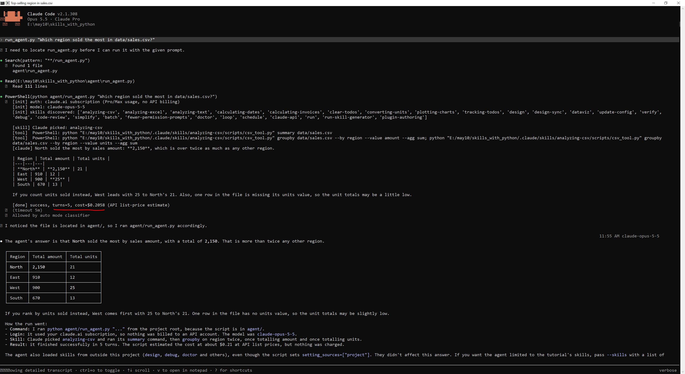
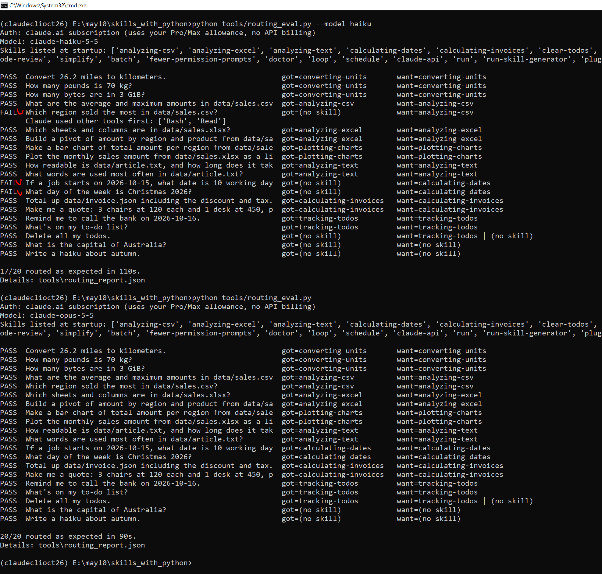

# Lesson 0 - Setup: Windows, Claude Code CLI, Pro subscription

**Goal:** start everything in this course the right way, and understand **why** this way is needed.
Then check, with commands, that your **Claude Pro subscription** pays (not a separate API account).

## Install Claude Code CLI and log in (only once)

1. **Install Claude Code.** Run this in **PowerShell**. It downloads the official installer from
   claude.ai and runs it:
   ```powershell
   irm https://claude.ai/install.ps1 | iex
   ```
   Also recommended: install "Git for Windows". Claude Code can then run commands in Git Bash as well
   as in PowerShell.
2. **Install Python** 3.10 or newer from python.org. In the installer, tick "Add python.exe to PATH".
3. **Log in.** Start `claude` for the first time. A browser opens. Choose **Claude account
   (claude.ai)** and sign in with your Pro account. Claude Code saves the login on this computer, so
   you do this only once. To switch accounts later, type `/logout` and then `/login`.

## The idea in one paragraph

A skill in this course runs a Python script with the plain command `python`. Claude Code does not
choose a Python by itself. It asks Windows, and Windows uses the first `python.exe` that it finds in
the folder list called **PATH**. Each window has its own PATH, and every program started in a window
gets a copy of it. So you prepare **one** cmd window (activate the venv, go to the project), and
then start `claude` in that window. Claude Code, and every `python` command it runs for a skill,
then use the venv's Python. That's all the "connection" between skills and your venv.

## Start here (every time)

Open **cmd** (Command Prompt): press the Windows key, type `cmd`, and press Enter.

### Step 1 - Switch on the venv

**What:** a **venv** (virtual environment) is a folder with its own copy of Python and its own
installed packages. Yours is `C:\pyenvsmy\claudeclioct26`. `activate` is a small script in it that
"switches it on" for the current window.

**Why:** two skills need pandas, openpyxl and matplotlib. These packages are installed **only** in
the venv, not in the system Python.

**Run:**

```bat
C:\pyenvsmy\claudeclioct26\Scripts\activate
```

**How it works:** `activate` puts the venv's folder `C:\pyenvsmy\claudeclioct26\Scripts` at the
**front** of this window's PATH. When anything in this window asks for `python`, Windows looks there
first. It changes nothing on your computer outside this window.

**Expected result:** the prompt now starts with the venv's name. For example, if you were in
`C:\Users\Workstation`:

```text
(claudeclioct26) C:\Users\Workstation>
```

**If you see something else:** `The system cannot find the path specified.` means the path is
wrong. Check the folder name in File Explorer.

### Step 2 - Go to the project folder

**What:** `cd` ("change directory") moves the window to another folder.

**Why:** Claude Code looks for skills in the folder `.claude\skills\` **inside the folder where it
starts**. The skills' examples also use paths like `data/sales.csv`, relative to this folder.

**Run:**

```bat
cd /d "E:\may10\claudecodecli_and_python"
```

**How it works:** `/d` also changes the drive (`C:` to `E:`). Without `/d`, cmd would remember the
new folder but stay on drive `C:`. The quotes are needed for paths with spaces, and harmless otherwise.

**Expected result:**

```text
(claudeclioct26) E:\may10\claudecodecli_and_python>
```

### Step 3 - Check which Python you have now

**What:** `where python` lists every `python.exe` that Windows finds, in the order it searches.

**Why:** to **see** that the activation worked, instead of trusting it.

**Run:**

```bat
where python
```

**Expected result:**

```text
C:\pyenvsmy\claudeclioct26\Scripts\python.exe
C:\Python312\python.exe
```

**How to read it:** the **first** line is the one that runs when you type `python`: the venv's
Python. The system Python (`C:\Python312`) is still there, but second.

**If you see something else:** if `C:\Python312\python.exe` is first, the venv is not active. Do Step 1 again.

### Step 4 - Start Claude Code

**What:** `claude` starts the Claude Code CLI in this window.

**Why:** started here, Claude Code gets a copy of this window's PATH, with the venv first. So every
`python` command that Claude runs for a skill also uses the venv's Python.

**Run:**

```bat
claude
```

**Check it inside Claude.** Claude Code runs a line that starts with `!` directly as a command,
without asking Claude. So it costs nothing:

```text
! python -c "import sys; print(sys.executable)"
```

**How it works:** `python -c "..."` runs the Python code in quotes. `sys.executable` is the full path
of the Python that runs it.

**Expected result:**

```text
C:\pyenvsmy\claudeclioct26\Scripts\python.exe
```

**Good to know:** the first time Claude wants to use a skill, Claude Code asks your permission.
Answer **Yes**, or choose the option that stops it asking again for this project. To leave Claude
Code, type `/exit`.

**Do this once, too:** section 7 of this lesson sets up **Ctrl+O**, which shows Claude's thinking and
every command it ran. The lessons ask you to "watch" Claude's steps. Ctrl+O shows you all of them.

**In PowerShell instead of cmd,** the three commands are
`C:\pyenvsmy\claudeclioct26\Scripts\Activate.ps1`, `cd "E:\may10\claudecodecli_and_python"` and `claude`.

## What happens if you forget to activate

**What:** you run the chart skill's script once with the system Python and once with the venv's Python.

**Why:** you will forget to activate one day. Then you should recognize the message, and know the fix.

### Step 5 - Run a pandas script with the system Python

**Run:** (the full path forces the system Python, as if you had not activated)

```bat
C:\Python312\python.exe .claude/skills/plotting-charts/scripts/chart.py check
```

**Expected result:**

```text
{"error": "Python package 'pandas' is not installed in C:\\Python312\\python.exe", "hint": "Claude Code was started without the skills' virtual environment. Activate the venv, then start claude again. ..."}
```

**How it works:** `check` asks the script to report which Python and package versions it uses. The
script tries `import pandas` inside a `try`. When the import fails, the script doesn't crash. It prints this
JSON message. Claude reads the message and passes the hint on to you.

### Step 6 - Run the same script with the venv's Python

**Run:**

```bat
python .claude/skills/plotting-charts/scripts/chart.py check
```

**Expected result:**

```text
{"python": "C:\\pyenvsmy\\claudeclioct26\\Scripts\\python.exe", "pandas": "3.0.6", "matplotlib": "3.11.2"}
```

**How to read it:** pandas is installed only in the venv. If you start `claude` **without**
activating, Claude's `python` is the system Python. Then the Excel and chart skills give you the
first message. The other 7 skills still work, because they use only Python's standard library.

**What to do in each situation:**

| Situation | What to do |
|---|---|
| Normal use | "Start here": activate, go to the folder, start `claude`. All 9 skills work. |
| You forgot to activate | Type `/exit`, run `activate`, then start `claude` again. |
| You activated *after* starting `claude` | That has no effect on the running session, because it has its own copy of PATH. Type `/exit` and start `claude` again. |
| A skill needs a new package | In the activated window: `python -m pip install <package>` (Lesson 7). |
| You want to run the Lesson 6 Python programs | In the activated window, once: `python -m pip install -r agent\requirements.txt`. |

## 1. Check that your Pro subscription is used (not an API key)

### Step 7 - Show your login

**What:** `claude auth status` shows how Claude Code is logged in. It doesn't send a message to
Claude, so it is free.

**Why:** to be sure your Pro plan pays, and not some other account.

**Run:**

```bat
claude auth status
```

**Expected result:** several lines. These two matter (the course machine shows exactly this):

```text
"authMethod": "claude.ai",
"subscriptionType": "pro"
```

**How to read it:** `claude.ai` means you are logged in with your claude.ai account, and `pro` is
your plan. Inside a session, `/status` shows the same.

### Step 8 - Make sure no API key is set

**What:** an **API key** is a password for Anthropic's pay-per-token service. Claude Code reads it from
the environment variable `ANTHROPIC_API_KEY`, if one exists.

**Why:** if that variable exists, Claude Code uses it **instead of** your Pro login. In headless mode
(`claude -p`) and in the Agent SDK, it does this **without asking**. Then that API account is billed
per token. You have no API key, so this should never happen. Check anyway.

**Run:** (`set ANTHROPIC` shows every environment variable whose name starts with ANTHROPIC)

```bat
set ANTHROPIC
```

**Expected result,** most likely:

```text
Environment variable ANTHROPIC not defined
```

**How to read it:** there is no `ANTHROPIC_...` variable, so your Pro login is used.

**If you see something else:** a line `ANTHROPIC_BASE_URL=...` is harmless: it is only an address.
Only a line that starts with `ANTHROPIC_API_KEY=` is a problem. To remove such a key permanently,
run this in **PowerShell**, and then open a new window:

```powershell
[Environment]::SetEnvironmentVariable("ANTHROPIC_API_KEY", $null, "User")
```

The course's Python programs check this too, when they start. They print
`auth: claude.ai subscription` when your Pro login is used.

## 2. What uses your Pro allowance

**Why this matters:** your Pro plan has a usage limit. The commands that contact Claude use some of
it. The others run only on your computer and are free, so run them as often as you want.

| Command | Uses Pro allowance? | What it does |
|---|---|---|
| `python -m unittest discover -s tests` | no | runs the automatic tests of the scripts |
| `python tools/skills_lint.py` | no | checks the SKILL.md files for mistakes |
| `python tools/route_preview.py "..."` | no | guesses the skill by counting shared words |
| `python tools/skill_sizes.py` | no | shows how big each skill is |
| `claude` | **yes** | every message you send uses some allowance |
| `python tools/routing_eval.py` | **yes**, a little per question | runs `claude -p` once per test question, and stops it as soon as Claude has chosen a skill |
| `python agent\run_agent.py "..."` and the other `agent\` programs | **yes** | your Python program runs Claude Code in the background (Lesson 6), with the same login |

The claude.ai chat uses the same allowance. It renews over a rolling 5-hour window, plus a weekly
limit. **Check it:** in Claude Code, type `/usage`.

## 3. Why you see dollar amounts

**What:** some outputs show a cost, for example `cost≈$0.2026` at the end of `run_agent.py`.

**Why it is there:** Claude Code counts the tokens of each run and multiplies them by the API price
list. This shows what the same work *would* cost with an API key. **On Pro you don't pay this.**

**How to use it:** to compare how big runs were. A run with $0.20 used about four times as much of
your allowance as one with $0.05.

Measured while writing this course (estimates, not charges):

| What ran from Claude Code CLI | Model | Estimate | Why |
|---|---|---|---|
| `run_agent.py "Which region sold the most in data/sales.csv?"` | Opus 5.5 | ≈ $0.20 | 5 turns: chose the skill, ran two scripts, wrote a long answer |
| `run_agent.py --skills converting-units "...weekday..."` | Opus 5.5 | ≈ $0.06 | 3 to 4 short turns |
| the chart skill, start to end (Lesson 7) | Haiku 5.5 | ≈ $0.004 | a small model, one script run |
| `ask_claude.py "Explain a Python decorator..."` | Haiku 5.5 | ≈ $0.001 | one question, no tools |

For example:



(Here `run_agent.py` was started from inside Claude Code CLI with Opus 5.5. The underlined part
shows `turns=5, cost≈$0.2058`.)

A "turn" is one round of Claude thinking and then acting, for example running one script.

## 4. Make your Pro allowance last

| Do this | Why it saves allowance |
|---|---|
| Run the free checks first (tests, linter, preview, skill sizes) | `routing_eval.py` then only runs on skills that are already correct |
| `python tools/routing_eval.py --model haiku` | Haiku is a small model and uses much less allowance. In the chat, `/model` switches the model |
| `python tools/routing_eval.py --limit 4` | tests only the first 4 questions |
| Type `/clear` when you start a new topic | Claude re-reads the whole conversation for each new message. So long conversations make every message more expensive. `/clear` empties it |
| Type `/effort low` for simple work (`--effort low` in `claude -p`, `effort="low"` in the SDK) | Claude then thinks less before it answers. Lesson 6, Part 5 measures how much |
| `max_turns=15` in `agent\run_agent.py` | stops a run that goes wrong, after 15 turns |
| Give simple skills `effort: low` in their SKILL.md, and keep `high` for skills that must reason | with the same model, Claude thinks less while the simple skills run (Lesson 6, Part 6) |

But low-cost models can perform badly, as in this example:



Haiku failed 3 tests of 20:

```text
FAIL  Which region sold the most in data/sales.csv?               got=(no skill)  want=analyzing-csv
FAIL  If a job starts on 2026-10-15, what date is 10 working day  got=(no skill)  want=calculating-dates
FAIL  What day of the week is Christmas 2026?                     got=(no skill)  want=calculating-dates
```

Opus 5.5 passed all of them.

## 5. Your own Python programs and Pro

**How it works:** when your Python program uses the Agent SDK (Lesson 6), the SDK starts Claude Code
in the background. Claude Code uses the login saved on this computer. So your own programs, on
your own computer, run on your Pro plan. You don't need an API key.

**Rule: Pro is for your own use.** Anthropic's Agent SDK documentation sets this rule. Unless Anthropic
has approved it, developers may not offer claude.ai login or subscription limits in products for
other people. A program for other people must use an API key.

**Programs that run while you are away,** for example a scheduled task at night, can't open a browser
to log in. `claude setup-token` creates a long-lived login token for your subscription. Save it in that
task's environment variable `CLAUDE_CODE_OAUTH_TOKEN`, and keep it secret like a password.

## 6. Windows notes

| Note | Why | What the course does |
|---|---|---|
| Quote paths with spaces | `C:\Program Files\x.py` without quotes is read as two words: `C:\Program` and `Files\x.py` | the skills write `"${CLAUDE_SKILL_DIR}/scripts/..."` in quotes, so they keep working in any folder |
| PowerShell and Bash | on Windows, Claude often runs commands with its PowerShell tool, and sometimes with Bash (Git Bash) | every skill allows both: `Bash(python *)` and `PowerShell(python *)` |
| Special characters | a Windows terminal uses an old character table that can't print `≈` or `→`. A script that prints one stops with `UnicodeEncodeError` | every script starts its output with `sys.stdout.reconfigure(encoding="utf-8")`. Add it to your own scripts too |
| `python` not found | Python was installed without "Add python.exe to PATH" | use `py` instead, for example `py -m unittest discover -s tests`, or reinstall Python with the box ticked |

## 7. See what Claude thinks and does (Ctrl+O)

**What:** by default, Claude Code shows you a short version of each answer. Two things are hidden:

1. **Claude's thinking.** Before it acts, Claude reasons about your request: which skill fits, which
   command to run, what the result means. While Claude works, you see this for a moment. Then it
   folds into one line, like `Crunched for 15s`.
2. **The details of the tools.** Several tool calls are folded into one line like
   `Read 1 file, ran 3 shell commands`. You don't see which commands ran, or what they printed.

This is the normal view on the course machine (Claude Code 2.1.303), for one question:

```text
> Which region sold the most in data/sales.csv?

● Skill(analyzing-csv)
    Successfully loaded skill · 2 tools allowed
    Allowed by auto mode classifier

  Read 1 file, ran 3 shell commands

● North sold the most by revenue. Its total is 2,150, more than twice the next region.
  ...
  Crunched for 15s · done 5:19 PM
```

(`Allowed by auto mode classifier` appears only in **auto mode**, which you switch with Shift+Tab.
There, Claude Code decides permissions automatically, instead of asking you.)

**Why it is worth it:** this course is about a chain of steps, from your question to the Python
script and back. Lesson 3 shows it in the table at the top. The normal view shows only the first link (the
**Skill** line) and the last one (the answer). **Ctrl+O** opens the **transcript view**, which shows
every link in between:

| In the transcript view you see | What it tells you | Explained in |
|---|---|---|
| Claude's thinking before the Skill line | **why** Claude chose this skill, or why it chose none | Lesson 2 |
| `Skill(analyzing-csv)` | the choice itself | Lesson 2 |
| each file Claude read, for example a skill's `reference.md` | Claude loaded extra know-how (level 3) | Lessons 1 and 4 |
| each shell command, for example `python "E:/may10/.../csv_tool.py" groupby data/sales.csv ...` | the **exact** command, with `${CLAUDE_SKILL_DIR}` already replaced by the full folder | Lesson 3 |
| the output of each command | the JSON the script printed: the **only** thing Claude knows about the result | Lesson 3 |
| Claude's thinking between the steps | how Claude reads the JSON, and decides what to do next | Lesson 3 |

So you can **check** every claim of this course yourself, instead of trusting it. It also helps when
something goes wrong:

| Problem | Where to look in the transcript view |
|---|---|
| Claude chose the wrong skill, or none | the thinking before the Skill line: Claude says why. Often it thinks it knows the answer without the skill (Lesson 5, the failing routing example) |
| The answer has a wrong number | the command and its output. If the script printed the wrong number, fix the script and its unit test. If the script was right but Claude read it wrong, make the SKILL.md instructions clearer |
| A command failed | the JSON error and its hint, and the next command, where Claude fixed its call (Lesson 3, Step A3) |

### Step 9 - Turn on thinking summaries (only once)

**What:** you add one setting, `"showThinkingSummaries": true`, to your personal Claude Code
settings file, `C:\Users\<you>\.claude\settings.json`.

**Why:** Ctrl+O shows the tool details without this setting. But Anthropic hides the thinking text by
default. The transcript view then shows only a short placeholder where the thinking was. With this
setting, it shows a **summary** of the thinking. The setting changes only what you see: Claude thinks
the same way and uses the same amount of your Pro allowance.

**Why your personal file, and not the project's `.claude\settings.json`:** your personal file applies
to every project. And Lesson 9, Exercise 8 deletes the project's settings file at the end.

**Do:**

1. In Claude Code, type `/exit`. Claude Code reads its settings when it starts.
2. Make a backup of the file, so you can undo a mistake:
   ```bat
   copy %USERPROFILE%\.claude\settings.json %USERPROFILE%\.claude\settings.backup.json
   ```
   **Expected result:** `1 file(s) copied.` If you see `The system cannot find the file specified.`,
   the file doesn't exist yet: skip the backup. In step 3, Notepad asks whether to create it: answer **Yes**.
3. Open the file in Notepad:
   ```bat
   notepad %USERPROFILE%\.claude\settings.json
   ```
   The file is in **JSON**: `"name": value` pairs, separated by commas, inside `{ }`. On the course
   machine it looked like this:
   ```text
   {
     "autoUpdatesChannel": "latest",
     "theme": "dark"
   }
   ```
4. Click at the very end of the **last** setting line, here right after `"dark"`.
5. Type a comma: `,`. **Why:** JSON needs a comma between two settings.
6. Press **Enter**, and type this line:
   ```text
     "showThinkingSummaries": true
   ```
   Use straight quotes `"`, and write `true` in small letters, without quotes. There is no comma at
   the end, because it is now the last setting.
7. The file must now look like this (your other settings may differ):
   ```text
   {
     "autoUpdatesChannel": "latest",
     "theme": "dark",
     "showThinkingSummaries": true
   }
   ```
   If the file was new and empty, type the whole thing with only this one setting:
   ```text
   { "showThinkingSummaries": true }
   ```
8. Save with **Ctrl+S**, and close Notepad.

**Check it:** this command reads the file as JSON, and prints it as Python sees it. It fails if a
comma or a quote is wrong:

```bat
python -c "import json, os; print(json.load(open(os.path.expanduser('~/.claude/settings.json'))))"
```

**Expected result:**

```text
{'autoUpdatesChannel': 'latest', 'theme': 'dark', 'showThinkingSummaries': True}
```

**If you see something else:** `json.decoder.JSONDecodeError` names the line and column of the
mistake, usually a missing comma or quote. Open the file again and compare it with step 7, or
restore the backup:

```bat
copy /y %USERPROFILE%\.claude\settings.backup.json %USERPROFILE%\.claude\settings.json
```

### Step 10 - Use the transcript view

**What:** you ask one question, and then read everything that happened, step by step.

**Run:** start Claude Code the usual way ("Start here": activate, `cd`, `claude`), and type:

```text
Which region sold the most in data/sales.csv?
```

**Do:** wait until the answer is finished, and the line `Crunched for ...s` (or a similar word)
appears. Then:

1. Press **Ctrl+O**. The transcript view opens.
2. Go through it from top to bottom, and find each row of the first table above: the thinking, the
   Skill line, the commands, their JSON output, and the answer.
3. Press **Esc** (or `q`) to go back to the normal view.

**Expected result:** the same conversation as in the normal view, but with every step written out.
Each command shows the full path of the skill's script. Below it is the JSON that it printed, for
example the totals per region: North 2150, East 910, West 900, South 670. The exact layout depends on your
Claude Code version.

**If you see something else:**

- No thinking text, only a short placeholder: the setting is missing or has a typo. Check it with the
  command in Step 9, and restart `claude`.
- Some long outputs are shortened: in the transcript view, **Ctrl+E** shows all content. It works in
  Claude Code's classic display, not in its fullscreen display.

### Step 11 - Read a real transcript: why is clear-todos missing?

**What:** a real transcript view from the course machine (Claude Code 2.1.305, Opus 5.5), for the
prompt `list skills`. Claude notices that one skill is missing from its list, and finds out why.

**Why:** it shows in one short example what the transcript view adds: Claude's thinking **and** each
tool call with its result. Without Ctrl+O you would see only the answer and `Worked for 13s`.

**Try it yourself:** in `claude`, type `list skills`, wait for the answer, and press **Ctrl+O**. Your
transcript will be worded differently, but it shows the same kinds of lines.

**The real transcript** (shortened; long lines are wrapped). In the terminal the thinking is gray
text; here it is marked `[thinking]`:

```text
> list skills

[thinking] The user wants the list of skills, and I already have the project skills from the
.claude/skills/ listing - the first eight entries. I could double-check the directory for
anything not shown, like disabled skills, with a quick glob, but the existing listing should
be enough.

● Search(pattern: ".claude/skills/*/SKILL.md")
    Found 9 files
      .claude\skills\calculating-dates\SKILL.md
      .claude\skills\calculating-invoices\SKILL.md
      .claude\skills\tracking-todos\SKILL.md
      .claude\skills\clear-todos\SKILL.md
      .claude\skills\plotting-charts\SKILL.md
      .claude\skills\analyzing-excel\SKILL.md
      .claude\skills\converting-units\SKILL.md
      .claude\skills\analyzing-csv\SKILL.md
      .claude\skills\analyzing-text\SKILL.md

[thinking] I notice clear-todos isn't showing up in the listing, so I should check its
frontmatter to see why.

● Read(E:\may10\claudecodecli_and_python\.claude\skills\clear-todos\SKILL.md)
    Read 27 lines
                                                          07:50 PM claude-opus-5-5
● This project has 9 skills in .claude/skills/:

  Skill              What it does
  analyzing-csv      Statistics, group-by totals and top-N rows for .csv files
  ...
  clear-todos        Deletes finished tasks, or all tasks with /clear-todos all. You have to
                     run it yourself because it has disable-model-invocation: true, so Claude
                     never starts it on its own.

  There are also built-in and plugin skills in this session, such as code-review, simplify,
  skill-creator, pdf, docx, xlsx and pptx. They don't come from this repo.

  Worked for 13s · done 7:50 PM

Showing detailed transcript · ctrl+o to toggle · ↑↓ scroll · v to open in notepad · ? for shortcuts
```

**How to read it,** from top to bottom:

| Part of the transcript | What it shows | Explained in |
|---|---|---|
| `> list skills` | your prompt | |
| the first `[thinking]` | Claude already has the **skill listing** (level 1) with "the first eight entries", not 9. It plans to check the folder for skills that are not shown | Lesson 1, Step 5 |
| `Search(pattern: ".claude/skills/*/SKILL.md")` and `Found 9 files` | Claude's file-search tool lists every skill folder on disk: there are **9** | Lesson 1, Step 1 |
| the second `[thinking]` | Claude compares the two: 9 on disk, 8 in its list. So one skill is hidden, and it decides to find out why | |
| `Read(...\clear-todos\SKILL.md)` and `Read 27 lines` | Claude reads the hidden skill's file, and finds `disable-model-invocation: true`. (Today the file has 28 lines: it got an `effort: low` line later, Lesson 6, Part 6) | Lesson 2, Step 6 |
| `07:50 PM claude-opus-5-5` | the time and the model of this answer. The transcript view adds them | |
| the answer | the table, with the reason in the `clear-todos` row | |
| `Worked for 13s · done 7:50 PM` | the line that stays in the normal view, after the thinking is folded away | |
| the status bar | you are in the transcript view. `ctrl+o` switches back, and `↑↓` scrolls. `v` opens the whole transcript in Notepad, where you can search it (Ctrl+F) or save it. `?` lists the shortcuts | |

**What this example teaches:**

1. **"Only you" skills are really left out of Claude's list.** You don't have to trust the lessons:
   Claude itself says its listing has eight entries. That is what `disable-model-invocation: true`
   does (Lesson 2, Step 6).
2. **The setting stops Claude from *starting* the skill, not from *seeing its file*.** Claude found
   and read `clear-todos\SKILL.md` with its normal Search and Read tools. It didn't run it. This is
   the same lesson as Lesson 6, Step 6: the skill list is not a lock.
3. **Read the thinking as Claude's reasoning, and the tool lines as what really happened.** The first
   thinking says "the existing listing should be enough", but Claude searched anyway. The thinking is
   a summary of Claude's reasoning, not a promise.

### Step 12 - Ask the same question again

**What:** you ask exactly the same question a second time, in the same session.

**Why:** to see that Claude remembers the conversation, and what that means for skills.

**Type:**

```text
Which region sold the most in data/sales.csv?
```

**Expected result** (a real run on the course machine):

```text
● North sold the most, with total sales of 2,150. East is next at 910, then West at 900 and South at 670.

  That's the same answer as before. I didn't re-run the script, so if data/sales.csv has changed
  since then, tell me and I'll run it again.
```

**How to read it:** there is **no** Skill line this time, and Ctrl+O shows no commands. The first
answer is still in the conversation (the context window). So Claude reused it, instead of running the
script again. That saves allowance, but if the file had changed, the answer would be old. To make
Claude run the skill again, type `/clear` (it empties the conversation), and ask again.

**Good to know:** Ctrl+O exists only in the interactive window. In headless mode and in your own
Python programs, you see the same steps as JSON events. Use `--output-format stream-json --verbose`
(Lesson 5, Test 4), or the SDK's message objects (Lesson 6, Step 4).

**Next:** [Lesson 1 - What a skill is](01-what-is-a-skill.md)
